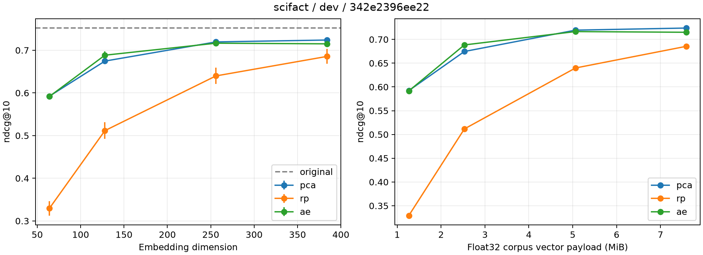

# Measured experiment summary

Measured on the complete official corpus; no relevance labels used for fitting.

Study ID: `342e2396ee22`; split: `dev`.

| Method | Dimension | Seeds | ndcg@10 mean ± sample std | Search p50 mean (ms) |
|---|---:|---:|---:|---:|
| ae | 64 | 3 | 0.59166 ± 0.00370 | 0.068 |
| ae | 128 | 3 | 0.68838 ± 0.00901 | 0.099 |
| ae | 256 | 3 | 0.71648 ± 0.00312 | 0.170 |
| ae | 384 | 3 | 0.71501 ± 0.00539 | 0.226 |
| original | 768 | 1 | 0.75201 ± 0.00000 | 0.601 |
| pca | 64 | 1 | 0.59230 ± 0.00000 | 0.065 |
| pca | 128 | 1 | 0.67457 ± 0.00000 | 0.102 |
| pca | 256 | 1 | 0.71950 ± 0.00000 | 0.168 |
| pca | 384 | 1 | 0.72392 ± 0.00000 | 0.233 |
| rp | 64 | 3 | 0.32941 ± 0.01675 | 0.069 |
| rp | 128 | 3 | 0.51161 ± 0.01955 | 0.101 |
| rp | 256 | 3 | 0.63982 ± 0.01900 | 0.184 |
| rp | 384 | 3 | 0.68552 ± 0.01753 | 0.256 |

Original/PCA are deterministic fits and run once; std=0 is not a confidence bound.
AE/RP std describes seed variation. Per-run query bootstrap intervals are in result.json.
Search latency excludes Transformer encoding and compression; no end-to-end speedup claim.
Inspect runs.csv, summary.csv, per_query.json, ranking.jsonl and case-selection.json.
Training history is reconstruction on a corpus-only diagnostic probe, not validation retrieval.
Model/data/source hashes and full configuration are in study.json and the embedding manifest.
