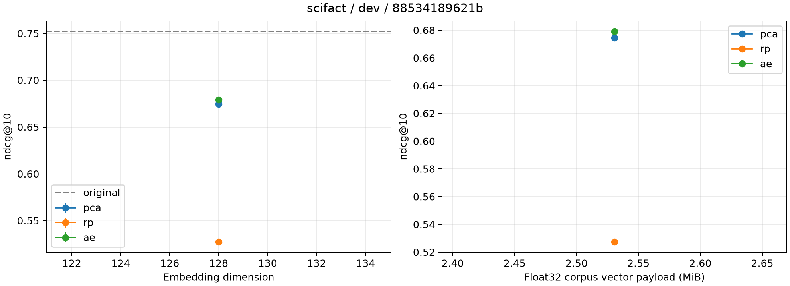

# Measured experiment summary

Measured on the complete official corpus; no relevance labels used for fitting.

Study ID: `88534189621b`; split: `dev`.

| Method | Dimension | Seeds | ndcg@10 mean ± sample std | Search p50 mean (ms) |
|---|---:|---:|---:|---:|
| ae | 128 | 1 | 0.67907 ± 0.00000 | 0.099 |
| original | 768 | 1 | 0.75201 ± 0.00000 | 0.539 |
| pca | 128 | 1 | 0.67457 ± 0.00000 | 0.093 |
| rp | 128 | 1 | 0.52746 ± 0.00000 | 0.104 |

Original/PCA are deterministic fits and run once; std=0 is not a confidence bound.
AE/RP std describes seed variation. Per-run query bootstrap intervals are in result.json.
Search latency excludes Transformer encoding and compression; no end-to-end speedup claim.
Inspect runs.csv, summary.csv, per_query.json, ranking.jsonl and case-selection.json.
Training history is reconstruction on a corpus-only diagnostic probe, not validation retrieval.
Model/data/source hashes and full configuration are in study.json and the embedding manifest.
