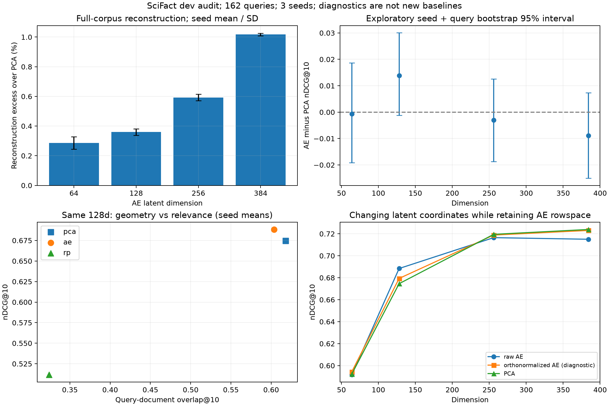

# SciFact dev：结果复核、诊断与改进建议

复核日期：2026-10-26。原始study：`342e2396ee22`；完整5,183文档、162个内部dev queries、四个压缩维度、RP/AE各3 seeds。只使用dev进行诊断；没有读取test检索结果或调整其报告。

## 1. 判断

**现有分数能够通过独立重算和选定配置的重新训练，未发现导致当前结果失真的评分、检索或参数保存错误。** 当前是可信的单数据集dev基线，尚不足以支持跨数据集结论，或“AE整体显著优于PCA”。

最值得改进的是统计解释、中心化控制、固定权重的最终评估、跨域验证与错误分析。AE重建已经接近同维PCA最优值，不建议仅为了让dev分数上涨而继续堆训练步数。

本次保留原始四法结果；额外centered-full-D、encoder行空间正交化只作为诊断，不替换原始baseline。

## 2. 具体如何verify

| 检查 | 实际结果 | 证据 |
|---|---|---|
| 29个run记录的artifact checksums | 全部一致 | numerical-replay.json |
| 载入compressor，从原始缓存重新transform，与保存FAISS向量比较 | 全部通过 | numerical-replay.json |
| 独立scalar Python重算每个query的nDCG/Recall/MRR及macro mean | 所有cutoff一致 | numerical-replay.json |
| NumPy float64对完整corpus穷举，而非调用FAISS再次验证FAISS | 每个run的162个queries的top10全部一致 | numerical-replay.json |
| float64穷举与保存排名的最大score gap | 约1.235e-7；nDCG@10差为0 | numerical-replay.json |
| 重新fit PCA128、RP128 seed42、AE128 seed42 | 保存的部署参数最大差为0，query变换一致 | retraining.json |
| 原有软件验证 | 20项测试重跑通过 | 本轮命令记录 |
| 新增审计数学检查 | 3项通过：缺失query、seed不确定性、常量差值 | tests/test_audit.py |

训练复现仅覆盖上述选定配置及本机CPU环境；没有声称12个AE全部重新训练，或跨MPS/CUDA逐bit复现。未重新下载模型并生成第二份embedding，因此本次复核主要验证给定冻结embedding缓存之后的管线。缓存checksum、固定模型revision和预处理也经过检查。

## 3. 当前结果怎样评价

Original768d nDCG@10=0.75201。下列都是相同dev查询和完整库：

| 维度 | PCA | AE mean±sample SD | RP mean±sample SD | 向量payload缩减倍数 |
|---|---:|---:|---:|---:|
| 64 | 0.59230 | 0.59166±0.00370 | 0.32941±0.01675 | 12× |
| 128 | 0.67457 | 0.68838±0.00901 | 0.51161±0.01955 | 6× |
| 256 | 0.71950 | 0.71648±0.00312 | 0.63982±0.01900 | 3× |
| 384 | 0.72392 | 0.71501±0.00539 | 0.68552±0.01753 | 2× |

PCA是当前很强的基线。RP低维退化很明显，但矩阵分布、固定seed、保存及重算都符合定义，低分本身不是实现错误。

若此时需要选一个待验证的效率/质量折中，**PCA256d**值得优先：保留原始nDCG约95.68%，文档向量payload约为1/3；PCA384d约96.26%，但payload为1/2。这个建议只针对当前dev，应在冻结选择规则后检验test与其他数据集。

不能写“几乎无损”而不注明具体损失：PCA256−Original nDCG差为−0.03252，paired query bootstrap区间约[−0.05251,−0.01411]，在这组查询上仍有明确质量下降。PCA256−384的差为−0.00443，区间[−0.01920,0.01044]；区间跨0不证明两者等价。PCA128−256下降约0.04493，区间[−0.06886,−0.02262]。

这些是事后探索性比较，未进行多重比较校正，也不是预注册非劣效性检验。[pca-tradeoff-comparisons.json](pca-tradeoff-comparisons.json) 保存完整计算。

## 4. 128维AE看起来更高，但证据有多强

AE128三个种子均值比PCA128高0.01381。只挑seed17会给出更好看的结果，但它不能代表整个训练过程。

本次构造 `delta[seed,query]`，独立抽取seed行和query列，同一bootstrap内所有seed使用同一组query，进行10,000次crossed resampling。没有把3×162条分数当作486个独立query。思路参考[MultiBERTs §3](https://arxiv.org/html/2106.16163v2#S3)。

| 维度 | AE mean−PCA | 探索性seed+query 95%区间 |
|---|---:|---:|
| 64 | −0.00064 | [−0.01909,0.01871] |
| 128 | +0.01381 | [−0.00115,0.03004] |
| 256 | −0.00301 | [−0.01877,0.01254] |
| 384 | −0.00891 | [−0.02500,0.00730] |

各区间均跨0。正确表述是“128d出现一致的seed点估计增益趋势，但当前样本与seed数量不足以确认稳定优势”。这不是证明没有差异。只有3个训练seed，对训练分布的估计仍很粗；若正式报告要重点主张该小增益，可事先固定5–10 seeds，只扩展这一关键比较，而非挑最好的seed。

不能把多个维度/方法/指标都看过之后，偶然未跨0的单次区间写成整张表的确认性结论。统计解释的基础可参考[Dror et al., ACL2018](https://aclanthology.org/P18-1128/)。

## 5. AE是否训练不充分

在完整corpus上计算与训练相同reduction的平方重建误差，并与相同中心化数据的同维PCA最优值比较：

`L*_PCA = sum_{j>d}(singular_value_j^2) / N`。

| 维度 | AE重建误差超出PCA floor的平均相对比例 |
|---|---:|
| 64 | 0.287% |
| 128 | 0.360% |
| 256 | 0.593% |
| 384 | 1.018% |

说明3,000步后重建已经非常接近最优。不是精确全局收敛证明：384d仍可能缩小约1%的重建gap，低方差尾部方向的子空间角度也未必完全一致。但没有强证据表明继续训练是改进retrieval最划算的方向。

AE encoder奇异值condition number约1.67–2.71，不是严格正交基。固定decoder–encoder重建映射时，可逆latent坐标变换仍可改变cosine；因此重建近似PCA，并不意味着检索排名相同。[Plaut 2018](https://arxiv.org/abs/1804.10253)。

诊断性地保留AE encoder行空间，只换成正交坐标后：

- 384d原AE平均nDCG=0.71501，正交化行空间约0.72304，更接近PCA0.72392。
- 128d原AE平均0.68838，正交化后约0.67935，部分增益消失。

这支持“latent度量参与了差异”的解释，不能把AE384不升一概归咎于训练不足，也不能据此宣布正交化总能提高检索。正交化是附加诊断，不是当前Standard AE的定义。

## 6. 一个非常重要的控制：PCA的中心化影响

新增的“仅减corpus均值、维度仍为768、再normalize”诊断：

| 设置 | nDCG@10 |
|---|---:|
| Original768 | 0.75201 |
| Centered768，未降维 | 0.72762 |
| PCA384 | 0.72392 |
| PCA256 | 0.71950 |

仅中心化就产生约0.02439下降。因此不能把Original→PCA的全部损失都叫“删维度损失”。在Original→centered768→PCA384这条顺序中，很多下降已出现在第一步；这不是对全部机制的独立因果归因。

改进建议：报告加入这个full-D centered control；若进一步探索uncentered-SVD或给RP增加centered版本，单独命名并保留原baseline。不要只对某个方法事后选择最有利预处理，再仍称统一协议。

## 7. 与proposal最相关的现象

同为128维：

| 指标 | PCA | AE三seed均值 |
|---|---:|---:|
| nDCG@10 | 0.67457 | 0.68838 |
| query→doc overlap@10 | 0.61790 | 0.60370 |
| doc→doc overlap@10 | 0.69336 | 0.68320 |

AE保留较少原始近邻，却得到较高检索点估计。这个描述性例子说明近邻保持不能直接代替relevance评价，与研究问题有直接关系。但统计区间仍较宽，不能推广成“几何保持越差检索越好”。

64d还出现Recall与nDCG不同方向：AE Recall@10略高于PCA，而nDCG近似持平/略低。报告应同时呈现“召回了多少”和“排得多靠前”。



## 8. 截断与错误案例

按实际缓存模型revision的tokenizer、相同prefix/title拼接、包含special tokens统计：

- Corpus 5,183文档中466个超过512 tokens，约8.99%；最长1,941 tokens。
- 162个dev queries均未超过512 tokens。
- 171个唯一dev相关文档中36个超过512 tokens，约21.05%。

这是四法共享的上游限制，不是PCA/AE压缩代码特有错误，也不是截断造成某次失败的因果证明。应补写局限和案例；若要做chunking，需要重新定义文档检索/聚合协议，不能直接破坏原qrels文档单位。

按AE128三seed平均相对PCA的变化，对称选取最大3个改善和3个恶化查询，保存在[balanced-cases.json](balanced-cases.json)。例如：

- query211：同一相关文档在Original第1，PCA128第24，AE128三seed第7/5/8。它说明AE相对PCA有改善，但仍没有恢复Original第1。
- query494：相关文档在Original第6，PCA128第10，AE128三seed第33/13/16，导致top10命中丢失。

这些是已核对的排名变化，不凭医学/语义猜测失败机制。报告应同时展示成功和失败，不只挑query211。

## 9. 值得改进的顺序

1. **先增强报告解释**：加入中心化control、同维geometry/task比较、seed+query统计和上述失败案例。当前代码基线已经可信，这些是低成本且与研究问题直接相关的提升。
2. **冻结模型工件后评估test**：建议加“读取保存compressor直接评价新split”的入口，保存权重checksum。当前test命令会重新fit，虽然本机seed42可精确重现，但最终报告直接评价固定工件更清楚。当前尚未实现该新入口，本次也没有运行test。
3. **跨数据集验证**：优先NFCorpus，再FiQA。数据准备已好；不要继续在SciFact dev上追分代替泛化证据。
4. **只对关键小差异扩seed**：如果要主张AE128优势，再事先固定额外seed。若只是呈现总体trade-off，现有三seed足以报告探索性趋势，无需铺满超参。
5. **规范效率证据**：重新计时前控制负载/顺序，至少两轮；把query encoding/projection/search分开，文件大小包含compressor成本。当前payload图和search-only latency定义诚实，但不能推断完整线上加速倍数。
6. **补全实验归档**：下一轮运行应把AE training decoder与training.csv也纳入完成检查；当前run记录的核心部署权重/index/per-query等都有校验，但decoder文件只记录了大小。本次已补存辅助文件当前hash，并保存与原study核心source hash一致的可恢复源码包[original-source.zip](original-source.zip)。这些新hash不能追溯证明辅助文件在原训练到审计之间从未修改，边界记录在[supplementary-provenance.json](supplementary-provenance.json)。正式写报告前仍应固定项目版本。

不建议为了让AE赢而删除强PCA、挑best seed、改变test后再选规则，或把非线性/正交约束新模型悄悄替换vanilla AE。RAE/QRAE继续保持规划范围。

## 10. 复现本轮审计

在仓库根目录，使用已锁定环境：

```bash
uv run python scripts/audit_study.py \
  --study runs/scifact/dev/342e2396ee22 \
  --output docs/verification/scifact-dev --retrain

# 单独进程使用tokenizer，避免与FAISS的native runtime混用。
uv run python scripts/audit_tokenization.py \
  --study runs/scifact/dev/342e2396ee22 \
  --output docs/verification/scifact-dev/tokenization.json

uv run python scripts/summarize_audit.py \
  --study runs/scifact/dev/342e2396ee22 \
  --audit docs/verification/scifact-dev

uv run pytest -q
```

主要证据：[numerical-replay.json](numerical-replay.json)、[retraining.json](retraining.json)、[diagnostics.json](diagnostics.json)、[tokenization.json](tokenization.json)、[原始结果](../../results/scifact-dev/report.md)。补充方法论见[研究笔记](../../../research/result-verification-research.md)。

最终全量测试为23项通过，Ruff lint/format通过。
